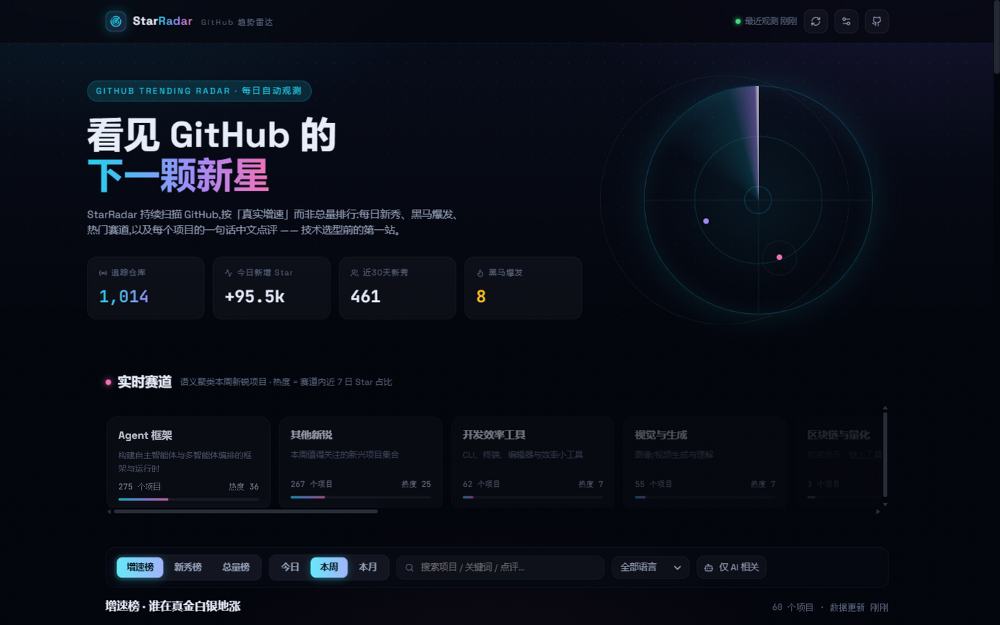
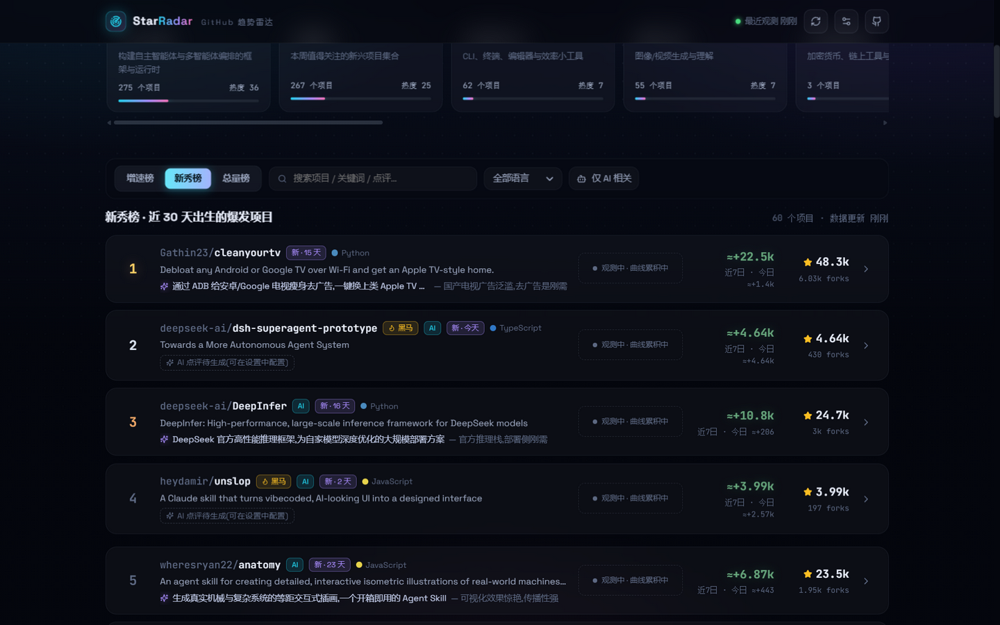
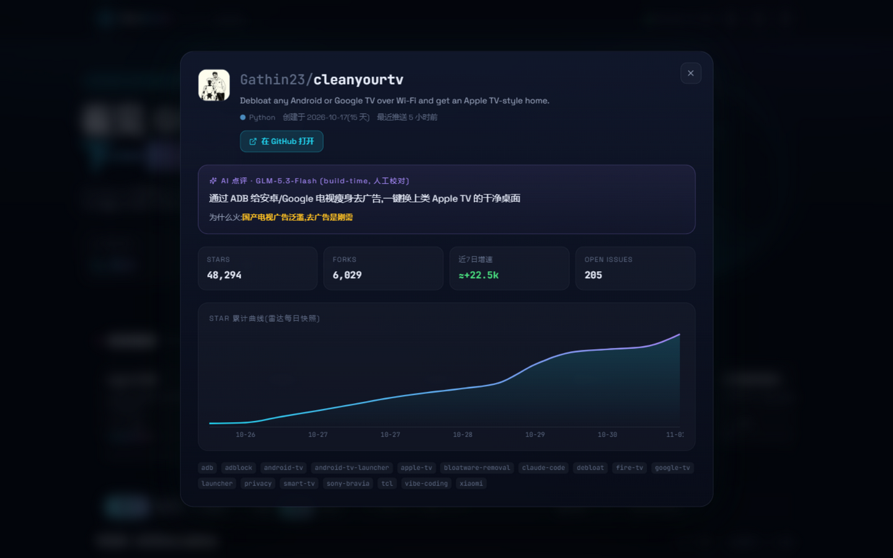

<div align="center">

# StarRadar

**GitHub 趋势雷达** · A self-hosted radar for GitHub trending

每天自动观测 GitHub:按「真实增速」而非总量排行,新秀、黑马、赛道聚类、中文点评 —— 一页看懂 GitHub 正在发生什么。

  

**界面预览**

<p>
  
</p>
<p>
   
</p>

</div>

## 这是什么

一个自托管的 **GitHub trending 观测工具**:不爬 trending 页面,直接走 GitHub API,自己测每个仓库的 star 增速、积累每日快照,再用 LLM 把"它是什么、为什么火"讲成人话。

- trending 总量榜的问题:十年老项目常年霸榜,看不出"现在"什么在火;
- StarRadar 按窗口内**新增 Star** 排行,并持续快照校准 —— 更早发现正在起量的项目。

## 功能

- **增速榜**:按近 24 小时 / 7 天 / 28 天新增 Star 排序,带排名变化箭头(↑3 ↓2);
- **新秀榜**:创建 ≤ 30 天就起量的项目,早期项目的第一现场;
- **黑马标记** 🔥:日增速 > 3× 同语言中位基线的爆发者(最多标 8 个,防通胀);
- **双平台共振** 🌊:接 Hacker News(Algolia),GitHub 与 HN 同时起量的项目打共振标记 —— 真热还是刷出来的,一眼分辨;
- **实时赛道**:新锐项目自动聚成「Agent 框架」「语音与音频」等赛道;每条赛道有**专属页**(热度曲线 + 成员榜单),热度 = 赛道内近 7 日 Star 占比;
- **Watchlist 盯榜** ⭐:关注任意项目,破 1k/5k/10k 里程碑或单日暴增时推送;
- **关键词订阅** ⭐:用 GitHub 搜索语法定义自己的雷达(`topic:mcp stars:>100`),自动成为榜单页签;
- **每日简报 / 每周报告**:涨幅领先、新面孔、赛道升温/降温、过气项目,一页可分享,可推送到你的通道;
- **中文点评 + README 摘要** ✦:每个项目一句话「这是什么、为什么火」+ 两句话 README 摘要 + 同赛道相关项目推荐(可选,见下文配置);
- **降温榜 / 营销嫌疑标记**:曾上榜如今停滞的项目;营销话术明显、资料单薄的项目予以提示;
- **健康度**:近 7 日 commits、fork/star 比、代码规模、组织出品、同一作者多仓库刷榜提示;
- **体验**:j/k/Enter/键盘导航、URL 状态同步(榜单可分享)、明暗主题、紧凑密度、PWA 可安装;
- **全自动**:启动自检数据新鲜度,超 6 小时自动观测,之后每 30 分钟巡检。

## 快速开始

```bash
# Windows
start.bat

# macOS / Linux
./start.sh
```

打开 **http://127.0.0.1:8000** 即可。仓库自带种子数据库(近千个真实项目与赛道数据),开箱即有内容;前端已预构建,无需 npm install。

改动前端代码后重新构建:

```bash
cd frontend && npm install && npm run build
```

## 数据从哪来

| 环节 | 无凭证(默认) | 配置凭证后 |
|---|---|---|
| 项目发现 | GitHub Search API(9 组动态日期查询,ETag 缓存省配额) | 同左,可加大页数 |
| 增速测量 | 总量 ÷ 仓库年龄 估算,UI 标注 `≈`;每日快照差值自动校准 | stargazers `starred_at` 末页采样,**精确测量**最近 100 次 Star 时间,并生成星标节奏曲线 |
| 中文点评 / 赛道 | 无(点评区显示"待生成") | GLM 批量生成 + embedding 语义聚类 |

配置方式(二选一,环境变量重启生效):

```bash
export GITHUB_TOKEN=ghp_xxx   # GitHub:解锁精确增速采样 + 近7日 commit 数(star 时间戳接口必须认证)
export ZHIPU_API_KEY=xxx      # 智谱开放平台:中文点评 + 语义赛道 + 报告导语
```

**推送通道**(Watchlist 里程碑 / 暴增 / 简报):网页右上角 **设置面板** 里填飞书群机器人 Webhook 或
Telegram Bot Token + Chat ID,保存后点「发送测试通知」验证;不配外部通道,站内通知 + 浏览器桌面通知也始终可用。
也可以在设置面板粘贴智谱 API Key(仅存服务进程内存,即时生效)。

## API

```
GET  /api/board?board=velocity|fresh|total|cooling|sub&window=1d|7d|28d&lang=&q=&ai_only=&track_id=&sub_id=
GET  /api/tracks              赛道列表(含热度、代表项目)
GET  /api/tracks/view?label=  赛道详情(热度曲线 + 成员榜单)
GET  /api/repos/{full_name}   项目详情(快照 / 相关项目 / README 摘要懒加载)
GET  /api/stats               仪表盘统计
POST /api/refresh             立即观测一轮
GET  /api/watch               关注列表        POST /api/watch     DELETE /api/watch/{gh_id}
GET  /api/subs                订阅列表        POST /api/subs      DELETE /api/subs/{id}
GET  /api/report/daily|weekly 每日/每周报告   POST /api/report/push
GET  /api/notifications?since= 站内通知       POST /api/notifications/test
GET  /api/settings            推送通道配置    POST /api/settings
POST /api/llm/enable          注入 LLM key(运行时)
POST /api/llm/comment         为缺失项目生成点评
POST /api/llm/tracks          重做语义赛道聚类
```

## 目录结构

```
star-radar/
├── start.bat / start.sh        一键启动
├── data/star-radar.db          SQLite(种子数据随仓库附带)
├── backend/
│   ├── app/
│   │   ├── config.py           全部环境变量配置
│   │   ├── github.py           GitHub 客户端(ETag 缓存 / 限流感知 / star 采样)
│   │   ├── fetcher.py          抓取编排:搜索 → 增速 → 快照 → 黑马 → 点评 → 赛道
│   │   ├── ai.py               GLM 点评 / embedding / 赛道命名
│   │   ├── tracks.py           语义聚类 + 主题词典退化路径
│   │   └── main.py             FastAPI + 调度 + 静态托管
│   └── scripts/                CLI 抓取、种子点评数据
└── frontend/                   React + Recharts(构建产物已就位,后端直接托管)
```

## 设计取舍

- **诚实标注**:无 token 时所有增速为估算,UI 一律带 `≈` 前缀,页脚写明口径;不把估算伪装成测量。
- **黑马防通胀**:相对倍率 + 绝对增量双重门槛,全局最多 8 个。
- **赛道永不空白**:有 LLM 用 embedding 聚类,没有则退化为主题词典分组;某轮抓取一无所获时中止本轮,绝不覆盖已有榜单与赛道。
- **配额友好**:ETag 条件请求(304 不计费)、搜索结果去重合并、采样预算上限(默认 160 项目);HN 查询走免费 Algolia 接口。
- **网络拦截兜底**:api.github.com 被网络中间人拦截(证书校验失败)时,客户端自动降级为不校验并仅在 stats 里如实标注,功能不中断。

## 已知边界

- 未认证 GitHub API 限流(核心 60 次/时、搜索 10 次/分),抓取器遇限流会自动等待重试;完整体验请配置 `GITHUB_TOKEN`。
- Star 曲线需要时间生长:新部署只有估算增速,快照逐日积累后曲线与精度自动提升(配 token 立得精确曲线)。
